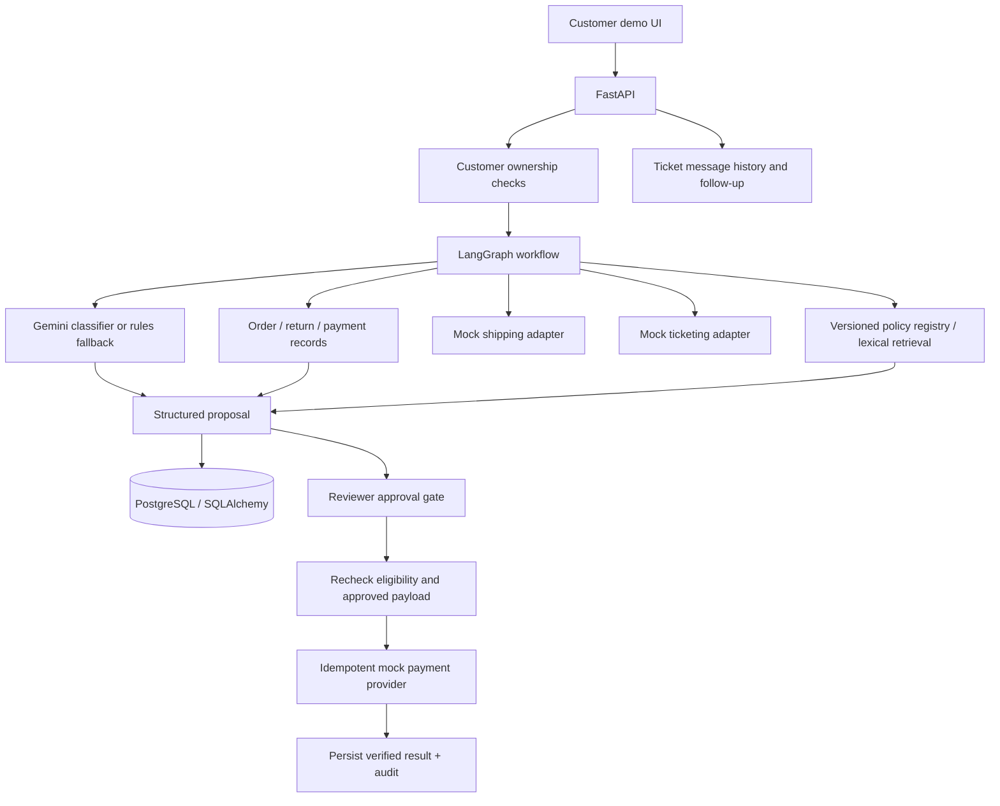

# Customer Support Resolution Agent

An FDE-oriented support workflow prototype that moves a customer issue from complaint to an evidence-backed, auditable outcome. It combines typed API tools, policy retrieval, optional Gemini classification, deterministic business rules, explicit reviewer approval, mock payment/shipping/ticketing adapters, customer clarification loops, and an evaluation-ready test suite.

> **Safety boundary:** This repository uses synthetic data and mock providers only. The model can classify a complaint, but it cannot authorize a refund. Eligibility, ownership checks, approval validation, and execution are enforced by application code.

## What works in this MVP

- FastAPI endpoints for tickets, workflow runs, proposals, events, and reviewer approvals.
- Customer identity supplied through a demo `X-Customer-ID` header; order ownership is checked server-side.
- LangGraph workflow when installed; deterministic orchestration fallback is provided for lightweight environments.
- Optional Gemini structured-output complaint classification. If no API key is configured or the model call fails, a rule-based classifier is used.
- Versioned policy registry ingested from Markdown frontmatter, effective-date filtering, immutable content hashes, section citations, and escalation when overlapping active versions conflict (transparent lexical baseline; not yet vector retrieval).
- Deterministic refund eligibility checks against order, return, and payment records.
- Mock shipping-service adapter that reads shipment records, detects missing/stale status, and supports deterministic failure/latency injection via `MOCK_SHIPPING_FAIL` and `MOCK_SHIPPING_DELAY_MS`.
- Idempotent mock ticketing-provider adapter with sync state on each ticket, audit events, timeout-after-accept reconciliation, and reviewer-triggered retry at `POST /runs/{run_id}/ticket-sync`. Use `MOCK_TICKETING_FAIL`, `MOCK_TICKETING_DELAY_MS`, and `MOCK_TICKETING_TIMEOUT_AFTER_ACCEPT` to exercise failure paths.
- Damaged-item clarification flow that asks for an order reference and damage/photo evidence before escalating to a support specialist; customer messages are persisted and ownership-checked.
- Human approval before any refund action; an approved request can be retried by the same reviewer to reconcile an uncertain provider result.
- Mock payment provider with idempotency-key reuse, changed-payload rejection, durable refund reservations, provider-first reconciliation, and deterministic failure/latency injection via `MOCK_PAYMENT_FAIL`, `MOCK_PAYMENT_DELAY_MS`, and `MOCK_PAYMENT_TIMEOUT_AFTER_ACCEPT`.
- Audit events for workflow start, proposal creation, investigation completion, and refund outcomes.
- A dark, responsive demo workspace at `/` with customer case entry, evidence, citations, approval, customer clarification, and audit views. Follow-up loops are capped to prevent runaway workflows.
- Shipment status is sourced from the shipping adapter; missing, stale, or unavailable tracking information is escalated rather than guessed.
- Seed scenarios for eligible refund, failed inspection, and an in-flight order.

## Architecture



### Key design decisions

- **LLM proposes; code disposes.** The classifier never decides refund eligibility or executes money movement.
- **Policies are not transaction facts.** Policy retrieval provides guidance and citations; order/payment facts come from database records.
- **Unknown is not success.** The customer-facing result is based on the mock provider's recorded status. A live Uvicorn restart test confirmed an accepted-but-timed-out refund can be reconciled after the app process restarts.
- **Approvals bind to a proposal.** Execution verifies the saved reviewer decision, expiry, proposal hash, and current eligibility.
- **Idempotency is explicit.** Reusing the same provider key and payload returns the same result; reusing a key with a different payload fails. The application commits a refund reservation before the provider call, looks up the provider operation before retrying, and records `pending_reconciliation` when a timeout makes the outcome uncertain. A partial unique index prevents two in-flight refund reservations for the same order. The mock payment and ticketing provider records commit independently, but currently live in the same database; they are not true network-service boundaries.
- **Demo authentication is not production authentication.** The static demo uses headers and a configurable reviewer token. Replace this with a proper identity provider before any real deployment.

## Quick start (local Python)

Python 3.11+ is recommended. Dependencies are declared in `pyproject.toml`; install the project and development tools from the repository root.

```powershell
# Windows PowerShell
py -3.11 -m venv .venv
.\\.venv\\Scripts\\Activate.ps1
python -m pip install --upgrade pip
python -m pip install -e ".[dev]"
Copy-Item .env.example .env
python -m alembic upgrade head
python -m app.db.seed
python -m uvicorn app.main:app --reload
```

For macOS/Linux, activate with `source .venv/bin/activate` and copy settings with `cp .env.example .env`; the remaining `python -m ...` commands are the same.

Open [http://127.0.0.1:8000](http://127.0.0.1:8000). API docs are at [http://127.0.0.1:8000/docs](http://127.0.0.1:8000/docs), and the health endpoint is [http://127.0.0.1:8000/health](http://127.0.0.1:8000/health).

The local default database is SQLite for zero-friction setup. Importing `app.main` does not create schema or touch the database; run the migration and seed commands before starting the server. No Gemini API key is required for the first run: the classifier falls back to deterministic rules. For a beginner-friendly setup and code walkthrough, see [First Run and Code Tour](docs/FIRST_RUN_AND_CODE_TOUR.md). To use PostgreSQL, set `DATABASE_URL` to a PostgreSQL SQLAlchemy URL; `psycopg[binary]` is included in the project dependencies.

## Docker Compose

```bash
cp .env.example .env
# Optional: add GEMINI_API_KEY to .env for model-assisted classification.
docker compose up --build
```

The API starts at port 8000 and PostgreSQL at port 5432. Compose applies Alembic migrations and seeds synthetic data on API startup. The reviewer token is demo-only and should be changed for local use.

## Demo scenarios

| Scenario | Customer | Order | Expected behavior |
|---|---|---|---|
| Eligible refund | `cust_ada` | `ord_1001` | Proposal pauses for reviewer approval; mock refund executes only after approval |
| Failed inspection | `cust_ada` | `ord_1002` | No refund proposal; case is marked for review/escalation |
| Refund without order | any seeded customer | none | Escalated without proposing a refund |
| Damaged item | `cust_ada` | `ord_1002` | Requests damage description and photo reference; escalates for specialist review after evidence is provided |
| Shipment status | `cust_grace` | `ord_2001` | Workflow retrieves the current seeded shipment status and tracking number; no refund action |

API customer requests use `X-Customer-ID`. Reviewer operations use `X-Reviewer-Token` and `X-Reviewer-ID`. Defaults are visible in `.env.example` and are not suitable for production.

## API surface

- `GET /health`
- `GET /demo/customers`
- `GET /demo/orders` (customer-scoped)
- `POST /tickets`
- `GET /tickets/{ticket_id}` (customer-scoped)
- `POST /tickets/{ticket_id}/runs`
- `GET /tickets/{ticket_id}/runs/latest` (customer-scoped recovery lookup)
- `POST /runs/{run_id}/resume` (reviewer-only resume from the latest durable checkpoint)
- `GET /tickets/{ticket_id}/messages` (customer-scoped)
- `POST /runs/{run_id}/messages` (customer-scoped; only while waiting for information)
- `GET /runs/{run_id}` (customer-scoped)
- `GET /runs/{run_id}/proposal` (customer-scoped)
- `GET /runs/{run_id}/events` (customer-scoped)
- `GET /approvals` (reviewer-authenticated)
- `POST /approvals/{approval_id}/decision` (reviewer-authenticated)
- `POST /runs/{run_id}/ticket-sync` (reviewer-authenticated; retries a pending ticketing sync)

## Tests

```bash
python -m pytest
python -m scripts.evaluate
# Also supported when running directly from the repository checkout:
python scripts/evaluate.py
```

Tests cover eligibility gates, missing/conflicting policy escalation, policy version transitions, proposal/approval payload binding, cross-customer access denial, import-safe startup, working-directory independence, payment and ticketing timeout/reconciliation, rollback recovery, durable checkpoint resume, request-ID propagation, write-endpoint rate limits, the single-in-flight-refund database constraint, missing/stale shipping evidence, shipping-provider outages, migration upgrade/downgrade, idempotent seed data, and the bounded damaged-item clarification loop.

The included synthetic evaluation exercises **60 deterministic cases** across six groups: order/shipping status, eligible refunds, ineligible refunds, missing/ambiguous complaints, payment/ticketing failure recovery, and authorization/adversarial checks. The current local run passed **60/60**, with **0 unauthorized actions** and **0 duplicate refund effects detected**. These are deterministic development checks—not production accuracy, customer resolution, or reliability claims. Expand and hold out cases before presenting benchmark results.

Review the [case-level evaluation report](reports/evaluation-baseline.json), [build and verification log](reports/iteration-log.md), and [specification audit](reports/specification-audit.md) for detailed results and the remaining external tasks.

## Updating policy versions

Policy files include `version`, `effective_from`, and `effective_to` frontmatter. To publish a new version, add a new Markdown file with the same policy title and a bumped version, set the old version's `effective_to` (exclusive), set the new version's `effective_from`, and run `python -m app.db.seed`. The policy body is immutable within a version; changing the body without a version bump is rejected. If two versions overlap, the workflow escalates rather than choosing one silently.

## Publish to a new GitHub repository

After extracting the ZIP, open a terminal in the `customer-support-resolution-agent` folder. If Git and GitHub CLI (`gh`) are installed and authenticated:

```bash
git init -b main
git add .
git commit -m "feat: initial customer support resolution agent"
gh repo create customer-support-resolution-agent --public --source=. --remote=origin --push
```

Choose `--private` instead of `--public` if you want the repository private. Do not commit `.env`, API keys, or local database files. The included `.gitignore` excludes them.

## Current limitations / next iterations

1. Replace demo header identity and static reviewer token with proper authentication/authorization.
2. Split mock payment, shipping, and ticketing adapters into separate HTTP services/databases to test genuine network timeouts and cross-service reconciliation.
3. Add the native LangGraph checkpointer and a background worker; the current app-level snapshots support node-boundary recovery but do not schedule/resume jobs automatically.
4. Replace the in-memory rate limiter with a shared limiter for multi-worker deployments, and add production log shipping/retention controls.
5. Add embeddings/pgvector and compare retrieval quality against the version-aware lexical baseline.
6. Run the reservation/reconciliation suite against real PostgreSQL with concurrent workers and process restarts.
7. Add deployment configuration and operational dashboards/alerts.
8. Generate and commit a dependency lockfile when package-registry access is available.
9. Validate Gemini and installed-LangGraph execution in a network-enabled environment; this workspace used the deterministic fallback.
10. Connect real payment, ticketing, and shipping providers only after their API contracts and failure semantics are documented.

This is an intentionally bounded portfolio MVP, not a production refund system. Do not connect it to real payments or customer data.
